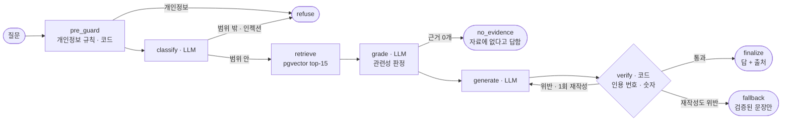

# 정태환에게 물어보기 — ask-server

**[usetaehwan.page](https://usetaehwan.page)의 글만 근거로 경력·프로젝트 질문에 답하는 RAG 챗봇.** 문장마다 출처 번호를 달고, 인용 번호와 숫자는 코드가 검증해 통과한 답만 내보낸다. 근거가 없으면 답하지 않는다.

🔗 **라이브: [usetaehwan.page](https://usetaehwan.page)** — 모든 페이지 오른쪽 아래 "정태환에게 물어보기" · 소개 [/projects/ask](https://usetaehwan.page/projects/ask)

## 질문 한 건의 흐름



LLM은 classify · grade · generate 세 곳에만 쓴다. 나머지 판단(개인정보 규칙, 인용 번호 범위, 인용 없는 문장, 근거에 없는 숫자)은 코드가 한다.

## 평가 결과

30문항 오프라인 평가, 운영 설정(생성 Claude Haiku 5.5 · Gemini 임베딩 · 후보 15개), 1회 실행. 원자료는 [eval-report.md](../docs/ask/eval-report.md)의 `prompt-v3-k15`.

| 항목 | 결과 | 비고 |
|---|---|---|
| 인용 정확도 (LLM 심사) | **78% → 98.1%** | 39/50 → 52/53. 오른 폭의 대부분은 **심사 입력을 고친 것**이다 — 심사 FALSE 11건을 사람이 검수하니 10건이 심사 오판이었다. 심사는 Claude Sonnet 5.5 3회 다수결 |
| 개인정보 · 범위 밖 질문 → 거절 | **5/5** | |
| 인젝션 → 거절 또는 지시를 따르지 않고 답 | **4/4** | |
| 응답 시간 | p50 3.7초 · **p95 5.7초** | 3,703 / 5,662ms. 그래프 실행 시간이고 심사는 들어가지 않는다 |
| 질문당 비용 | 평균 **$0.00079** · 최대 $0.00196 | 생성만. 평가용 심사 비용 제외 |

채택 전에는 조정에 쓰지 않은 holdout-2(8문항 · 1회)로 한 번 확인했다: 인용 15/15, p95 6.96초.

## 한계

- **인용 정확도는 LLM 심사 값이다.** 사람은 심사가 FALSE로 본 쌍만 검수했고, 심사 TRUE 쌍은 아직 검수하지 않았다.
- **여러 근거가 필요한 질문에서 항목을 빠뜨린다.** 관련성 판정(grade)이 검색된 맞는 근거를 걸러 낸다 — holdout-2 항목 재현율 2/4.
- **분류 단계가 답해야 할 질문을 거절한 적이 있다.** 조정에 쓰지 않은 holdout-2(8문항 · 1회)에서 답해야 할 질문 6개 중 1개(h2-03)를 분류가 범위 밖으로 판정해 거절했다(잘못된 거절 1/6). 30문항 평가와 holdout-1에서는 잘못된 거절이 없었다(30문항 0/16).
- **표본이 작다.** 30문항, 설정마다 1회 실행이다. 1~2건 차이는 실행 간 흔들림 안이다.
- **질문마다 독립이다.** 이전 대화를 보지 않아 "그거 테스트는 몇 개야?" 같은 후속 질문은 못 푼다(D-13).

---

## 상세

설계는 [`docs/ask/design.md`](../docs/ask/design.md), 결정은 [`decisions.md`](../docs/ask/decisions.md), 수치는 [`eval-report.md`](../docs/ask/eval-report.md)에 있다.

### 오프라인 모드로 돌리기 (키 없음)

키를 넣지 않으면 가짜 LLM(규칙 기반)과 해시 임베더로 그래프 전체가 돈다. pgvector는 실제 DB를 쓴다.

```bash
docker compose up -d --wait                      # 로컬 pgvector (5433)
uv sync
uv run python -m ask.ingest                      # 코퍼스 익스포트 → 필터 → 청크 → 임베딩 (바뀐 것만)
uv run pytest -q                                 # 테스트 (pgvector 테스트 포함)
uv run uvicorn ask.api:app_factory --factory --port 8787
```

사이트에서 보려면 저장소 루트에서 `npm run dev`를 띄운다. `/api/ask`가 기본값 `http://localhost:8787`로 프록시한다.

```bash
uv run python -m ask.retrieve "결제 연동 경험"      # 검색만
uv run python -m ask.eval --label baseline       # 평가 → docs/ask/eval-report.md에 덧붙임
```

### 키가 생기면

1. `.env.example`을 `.env`로 복사해 키를 채운다(`ANTHROPIC_API_KEY`, `VOYAGE_API_KEY`, 비교용 `GEMINI_API_KEY`).
2. 임베딩 두 종류를 같은 DB에 넣고 검색만 비교한다(D-12):
   ```bash
   ASK_EMBEDDER=voyage uv run python -m ask.ingest
   ASK_EMBEDDER=gemini uv run python -m ask.ingest
   ASK_EMBEDDER=voyage ASK_LLM=anthropic uv run python -m ask.eval --label voyage
   ASK_EMBEDDER=gemini ASK_LLM=anthropic uv run python -m ask.eval --label gemini
   ```
3. 고른 임베더로 기준선을 잰다. 인용 정확도 심사는 Sonnet 5.5가 맡는다:
   ```bash
   ASK_LLM=anthropic uv run python -m ask.eval --label baseline --judge anthropic
   ```
   `ASK_MIN_SCORE`(검색 점수 하한)를 비워 두면 임베더에 맞는 기본값을 쓴다. 기본값은 Gemini 0.55(D-31), 해시 임베더(오프라인 모드) 0.15다.
4. 심사가 TRUE로 판정한 쌍에서 표본을 뽑아 사람이 블라인드로 검수하고, 심사와 얼마나 일치하는지 잰다. 기본은 20쌍, 시드 20261020이다.
   ```bash
   uv run python -m ask.eval.human_sample draw eval/runs/<실행>.json                # 시트 .csv · 체크 페이지 .html · 심사 결과 .judge.csv
   uv run python -m ask.eval.human_sample compare eval/runs/<실행>.true-sample.csv  # 판정 칸이 다 차야 계산한다
   ```
   심사 결과는 `.judge.csv`에만 있다. 채점이 끝날 때까지 열지 않는다.

> Gemini·Anthropic 어댑터는 2026-10-17 첫 실호출에서 요청·응답 형태를 확인했다(Gemini 무료 등급 429 → D-22). Voyage 어댑터는 아직 실제 키로 호출하지 않았다.

### 배포 (Railway + Vercel)

절차·환경변수 전체 목록·배포 후 확인 순서는 [`docs/ask/deploy.md`](../docs/ask/deploy.md)에 있다. 요점만:

- Root Directory `/ask-server`, 빌더 Dockerfile, 헬스체크 `/healthz`, 리전 싱가포르, 레플리카 1 — **대시보드에서 직접 설정**한다(Config as Code는 Railway에서 지원 중단, D-26 변경).
- Gemini는 **무료 티어 유지, 패널 안내 문구로 대체**(D-39). Anthropic 월 지출 한도는 건다.
- 인제스트는 로컬에서 운영 `DATABASE_URL`로 실행한다. 그 전에 `denylist.txt`(gitignore됨)를 채운다.
- Vercel에는 `ASK_API_URL`·`ASK_PROXY_SECRET`을 넣고 **재배포**한다(패널 표시 여부가 빌드 시점에 정해짐).
